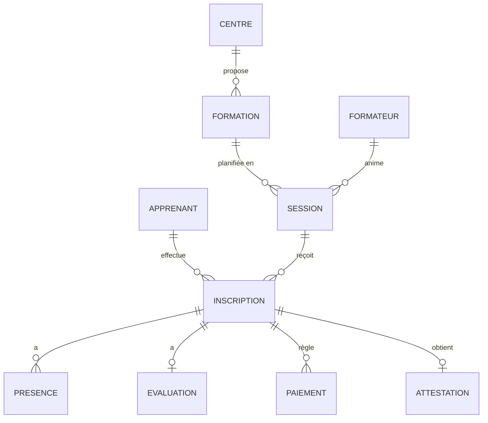

# FormaPlus - Gestion d'un centre de formation

Projet académique Django (Projet 8). Fonctionnalités :

- catalogue des formations et de leurs durées ;
- apprenants et formateurs, avec **inscription et connexion** (par adresse e-mail) ;
- sessions avec dates, lieu et capacité ;
- inscriptions (capacité et doublons contrôlés) et paiements ;
- feuille de présence, évaluations (note ou validation du formateur) ;
- **attestation PDF** générée lorsque les conditions de réussite sont remplies.

## Installation (Python 3.12 à 3.14, Django 5.1 ou plus)

```bash
python -m venv venv
# Windows : venv\Scripts\activate        Linux/Mac : source venv/bin/activate
pip install -r requirements.txt

python manage.py makemigrations accounts courses trainers learners training_sessions enrollments attendance certificates
python manage.py migrate
python manage.py seed_demo          # données de démonstration
python manage.py runserver
```

Ouvrir http://127.0.0.1:8000/

> `makemigrations` est à lancer une seule fois : il crée les fichiers de migration des 8 applications.

## Comptes de démonstration (créés par `seed_demo`)

| Rôle | E-mail | Mot de passe |
|------|--------|--------------|
| Administrateur | admin@formaplus.test | Admin12345 |
| Formateur | formateur@formaplus.test | Formateur12345 |
| Apprenant | apprenant@formaplus.test | Apprenant12345 |

Tout nouvel utilisateur peut aussi créer un compte (apprenant ou formateur) depuis la page
**Créer un compte**. Le compte administrateur se crée en ligne de commande :
`python manage.py createsuperuser`.

## Règles d'obtention d'une attestation

Définies dans `config/settings.py` (modifiables) :

| Réglage | Valeur par défaut |
|---------|-------------------|
| `ATTESTATION_PRESENCE_MIN` | 80 % des séances (1 séance par jour de session) |
| `ATTESTATION_NOTE_MIN` | note de 10/20, **ou** validation manuelle par le formateur |
| `ATTESTATION_PAIEMENT_OBLIGATOIRE` | `True` : inscription entièrement payée |

La règle est écrite dans `certificates/rules.py` (fonction pure et testée), appliquée par
`certificates/services.py`.

## Rôles et accès

- **Administrateur** : tout voir, enregistrer les paiements, annuler des inscriptions, administration Django (`/admin/`).
- **Formateur** : ses sessions uniquement ; présences, évaluations, génération des attestations.
- **Apprenant** : catalogue, inscription aux sessions, suivi de sa situation, téléchargement de son attestation.

## Structure

| Application | Rôle |
|-------------|------|
| `accounts` | profils/rôles, connexion, inscription, tableau de bord |
| `courses` | Centre, Formation |
| `trainers` | Formateur |
| `learners` | Apprenant |
| `training_sessions` | Session (nommée ainsi pour éviter le conflit avec `django.contrib.sessions`) |
| `enrollments` | Inscription, Paiement |
| `attendance` | Présence, Évaluation |
| `certificates` | Attestation, règles, PDF |

## Base de données



## Tests

```bash
python manage.py test
```

Les tests de la règle d'attestation (`certificates/test_rules.py`) n'ont pas besoin de base de données.
Le plan de réalisation du projet est dans `docs/Plan_de_realisation.pdf`.
